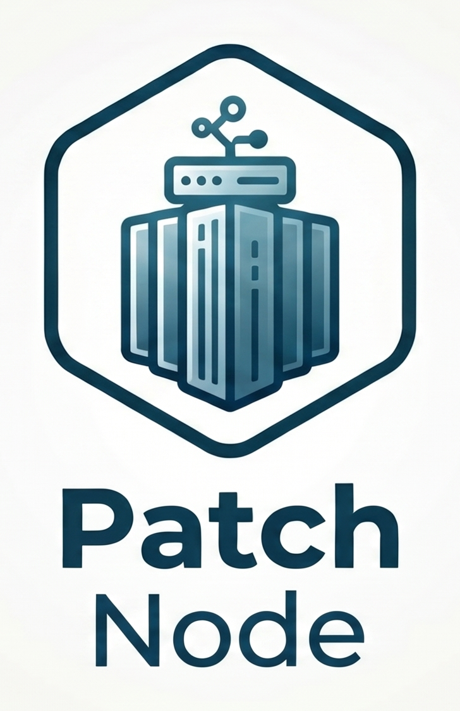
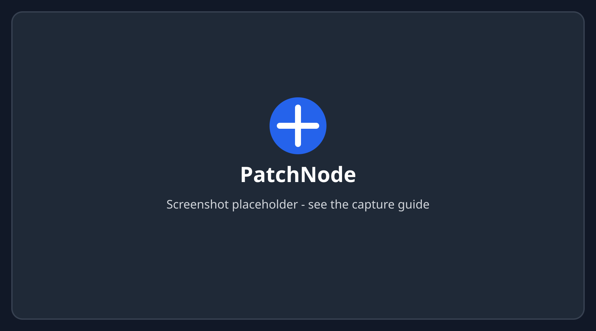

<div align="center">


<br>



# PatchNode

**Your whole homelab in your pocket: Proxmox, Docker, Tailscale, Grafana and more, on iPhone, iPad and Mac.**

PatchNode was formerly known as Labwatch.

PatchNode is a native SwiftUI dashboard for self-hosters. It talks directly to
your own services over your LAN or VPN, with least-privileged tokens kept in
the Keychain. No account, no cloud relay, no telemetry: just a fast look at
what is up, what is down, and a confirmed tap to restart what needs it.

[](LICENSE)
[](https://github.com/Patchbay-s/PatchNode/releases)
[](#get-started)
[](#architecture)
[](https://apps.apple.com/app/id6817931670)
[](https://www.reddit.com/r/selfhosted/)

<br>



<sub>Screenshot placeholder. Add a capture from demo mode; see <a href=".github/assets/screenshots/README.md">the capture guide</a>.</sub>

<br><br>

[Features](#features) ·
[Supported services](#supported-services) ·
[Security](#security-and-privacy) ·
[Get started](#get-started) ·
[Architecture](#architecture) ·
[Status](#status-and-roadmap) ·
[Patchbay's apps](#the-patchbays-apps) ·
[License](#license-and-credits)

</div>

---

## Features

Across every service:

- **One dashboard** with a card per service, a single "private network / VPN
  unreachable" banner instead of a wall of errors, and a warning when a TLS
  certificate expires within 14 days.
- **Widgets** (global status, Proxmox node load, stopped containers) and
  **Shortcuts** ("HomeLab status", "Restart a VM", "Restart a
  container"), always confirmed.
- **Local notifications**, all off by default: unreachable service, failed
  backup, unhealthy container, new alert, expiring certificate, disk problem.
- **Built-in guides** for every service: where to create the credential, which
  rights to give it, how to keep the service off the internet.
- **Demo mode** with realistic data for every service, to try the app without
  a homelab.
- **Optional iCloud sync** of the configuration between your devices, and
  **export / import** as a file or a QR code, never with the tokens.
- English, French, Spanish, German and Italian.

### Proxmox VE

- Nodes with CPU, RAM, storage and uptime; VMs and containers with filters and
  `rrddata` history charts.
- Start, shut down, stop and reboot a guest, with a confirmation naming it and
  task tracking until it finishes.
- Native backups without PBS: scheduled vzdump jobs, guests covered by no job,
  archives per storage, failures of the last 24 hours.
- Disk health: SMART status, SSD wear and ZFS pools. SMART is off, on demand
  (default) or once a day at the time you choose, so idle disks are not woken
  up by a refresh.
- Consoles (Proxmox VE 9.1+): text terminal for nodes, containers and VMs with
  a serial port, noVNC graphical console for the other VMs. If a right is
  missing, the exact `pveum` commands are shown.
- Works with several standalone nodes or a cluster.

### Proxmox Backup Server

- Datastores with used and available space.
- Recent tasks: backups, verifications, garbage collection, with failures
  highlighted.
- Read-only, with an `Audit` token.

### Docker (Portainer or socket proxy)

- Through Portainer's API or a Docker socket proxy behind your reverse proxy.
- Hosts and containers grouped by stack or Compose project, with state, health,
  CPU and memory.
- Logs with search, stdout and stderr decoded correctly.
- Start, stop and restart with confirmation (the socket proxy needs `POST=1`,
  Portainer a dedicated user).

### SSH, consoles and Docker Compose

- SSH client with an ed25519 key generated on the device, kept in the Keychain
  and never synced; host key fingerprint pinned on first contact; password
  asked when needed and never stored.
- Terminal with an extra keys bar, copy and paste, themes, and tabs on iPad and
  Mac (up to 8 sessions). "Enter the container" (`pct enter`) from a Proxmox
  container.
- Compose projects found from container labels: edit the `.yml` files and the
  `.env` (values masked), see the diff, validate with `docker compose config`,
  automatic `.bak` backups, then up, stop, restart or pull + up with live
  output. Portainer stacks through its API.
- Off by default; Face ID before every session or change.

### Tailscale

- Every device of your tailnet: name, OS, Tailscale IPs, user, client version.
- Online state and last seen, key expiry (or "never expires"), update
  available, devices waiting for authorization.
- Read-only OAuth client with the `devices:core:read` scope; full API keys are
  refused.

### Grafana

- Health of the instance and active alerts from Grafana Alerting.
- Your dashboards listed and opened in an embedded web view.
- Service account token with the `Viewer` role.

### Prometheus and Alertmanager

- Prometheus targets up and down.
- Favorite PromQL queries drawn with Swift Charts, with ready-made examples.
- Alertmanager: firing alerts with their labels, severity and start time.
- No token needed on a private network; basic auth from your reverse proxy is
  supported.

### Uptime Kuma

- Monitors of a status page with their current state.
- Recent heartbeats and uptime.
- Reads the public status page API: no credential to store.

### CrowdSec

- Active decisions (bans): IP or range, scenario, origin, expiry.
- Simulated decisions marked as such.
- Read-only bouncer key (`cscli bouncers add`).

### Nginx Proxy Manager

- Proxy hosts with their domains and forward target.
- Enabled or disabled, certificate and forced SSL, nginx configuration errors.
- A dedicated "View Only" user.

### AdGuard Home

- Protection on or off, version.
- DNS queries, blocked queries and average processing time.
- Top queried and top blocked domains.

### Home Assistant

- The entities you pin, with their state.
- Run the scenes and scripts you selected, with confirmation.
- Long-lived token of a non-admin user.

### Glances

- CPU, memory, swap, load averages and uptime of any machine.
- File systems usage and temperature sensors.
- Glances API v4 and v3, optional password.


## Security and privacy

- **Keychain only.** Tokens, passwords and the SSH key never touch SwiftData,
  iCloud Drive, `UserDefaults` or logs. By default they stay on the device and
  are readable only when it is unlocked. Syncing them through iCloud Keychain
  is a separate, explicit option, off by default, behind Face ID.
- **Each token is bound to its server**: it is never sent to another origin.
- **Private network access.** PatchNode reaches your services over your LAN or
  a VPN (Tailscale, WireGuard…). No port forwarding, no exposed admin panel.
- **HTTPS only**, certificates checked by the system, no App Transport Security
  exception. SSH host keys pinned.
- **Least privilege** by design: the guides create read-only credentials, and
  every action asks for a confirmation that names its target.
- **No telemetry.** No analytics, no account, no server of the developer. The
  privacy manifest declares no data collection.
- Face ID / Touch ID to open the app, content hidden in the app switcher.

Found a vulnerability? See [SECURITY.md](SECURITY.md).

## Supported services

| Service | What is shown | Actions | Authentication |
| --- | --- | --- | --- |
| Proxmox VE | Nodes, VMs, containers, history, tasks, backups, disk health | Start, shutdown, stop, reboot; terminal and noVNC consoles | API token (`PVEAuditor`, plus dedicated roles for actions and consoles) |
| Proxmox Backup Server | Datastores, space, tasks | — | API token (`Audit`) |
| Docker via Portainer | Hosts, containers by stack, stats, logs, stacks | Start, stop, restart; edit and redeploy stacks | Portainer access token |
| Docker via socket proxy | Containers by Compose project, stats, logs | Start, stop, restart (`POST=1`) | Basic auth from the reverse proxy |
| Docker Compose over SSH | Projects, files, diff | Edit, validate, up, stop, restart, pull | Device SSH key (ed25519) or password |
| Tailscale | Devices, IPs, last seen, key expiry, updates | — | OAuth client (`devices:core:read`) |
| Grafana | Health, alerts, dashboards | — | Service account token (`Viewer`) |
| Prometheus | Targets, PromQL charts | Save favorite queries | None or basic auth |
| Alertmanager | Firing alerts | — | None or basic auth |
| Uptime Kuma | Monitors, heartbeats, uptime | — | None (public status page) |
| CrowdSec | Active decisions | — | Bouncer API key |
| Nginx Proxy Manager | Proxy hosts, certificates, errors | — | "View Only" user |
| AdGuard Home | Protection, queries, top domains | — | Dedicated user (basic auth) |
| Home Assistant | Pinned entities | Run selected scenes and scripts | Long-lived token (non-admin user) |
| Glances | CPU, memory, load, disks, sensors | — | None or password |

## Get started

### For users

1. Find PatchNode on the [App Store](https://apps.apple.com/app/id6817931670), or try the demo mode
   first.
2. Make sure your phone can reach your homelab: on the LAN, or through your VPN
   (Tailscale, WireGuard…).
3. Create a **dedicated, read-only credential** for each service. For Proxmox
   VE, for example:

   ```bash
   pveum user add monitor@pve
   pveum acl modify / --users monitor@pve --roles PVEAuditor
   pveum user token add monitor@pve patchnode --privsep 1
   pveum acl modify / --tokens 'monitor@pve!patchnode' --roles PVEAuditor
   ```

   The in-app guide of each service gives the exact steps, including the extra
   roles for actions and consoles.
4. In PatchNode, **Settings › Add a service**: type, name, HTTPS address and
   token. The service is saved only once the connection test succeeds.

### For developers

```bash
git clone https://github.com/Patchbay-s/PatchNode.git
cd PatchNode
cp Config/Local.xcconfig.example Config/Local.xcconfig   # then set your DEVELOPMENT_TEAM
open PatchNode.xcodeproj
```

```bash
xcodebuild -scheme PatchNode -destination 'generic/platform=iOS Simulator' build
for p in Packages/*/; do (cd "$p" && swift test); done
scripts/check-pbxproj.sh && scripts/check-environment.sh && scripts/check-shipped-hosts.sh
```

Requires Xcode with the iOS 27 SDK. See [CONTRIBUTING.md](CONTRIBUTING.md) for
the conventions, the security rules and how to add a new service type.

## Architecture

SwiftUI app, Swift 6 with strict concurrency, split into local Swift packages
so that each family of services is built and tested on its own. Every provider
conforms to the same `ServiceProvider` protocol (`healthCheck()`, `summary()`).

| Layer | Module | Role |
| --- | --- | --- |
| App | `PatchNode/` | Screens, navigation, dashboard, settings, guides, Face ID lock, App Intents, background refresh, notifications |
| Widgets | `PatchNodeWidgets/` | WidgetKit extension fed by a snapshot shared through an App Group |
| Core | `Packages/PatchNodeCore` | HTTP client (timeouts, backoff, masked headers), Keychain store, SwiftData schema and migrations, iCloud sync, provider protocol, guides, demo catalog |
| Providers | `Packages/ProxmoxKit` | Proxmox VE and Proxmox Backup Server, backups, disk health, consoles |
| | `Packages/DockerKit` | Docker Engine API through Portainer or a socket proxy, logs demultiplexing, stacks |
| | `Packages/ObservabilityKit` | Grafana, Prometheus, Alertmanager, Uptime Kuma |
| | `Packages/SecurityKit` | CrowdSec, Nginx Proxy Manager, AdGuard Home |
| | `Packages/TailscaleKit` | Tailscale API with an OAuth client |
| | `Packages/HomeServicesKit` | Home Assistant, Glances |
| Remote access | `Packages/RemoteAccessKit` | SSH client (SwiftNIO SSH), Proxmox termproxy and VNC, Docker Compose |
| | `Packages/TerminalKit` | Shared terminal (SwiftTerm), palettes, demo shell |
| Tooling | `scripts/` | Static checks of the Xcode project, of SwiftUI environment injection and of shipped host names; site generator |
| Website | `site/` | Static website (privacy policy, support) deployed with GitHub Pages |

Persistence: SwiftData for the configuration (no secret in it), versioned
schema compatible with CloudKit; Keychain for every secret.

## Status and roadmap

Current app version: **1.2** (build **3**). The [v1.2.0 source release](https://github.com/Patchbay-s/PatchNode/releases/tag/v1.2.0) is available on GitHub.

PatchNode is actively maintained. Development and planned work are tracked in
the [roadmap](docs/ROADMAP.md).

**Available and in development**

- [x] iPad and Mac ("Designed for iPad") layouts, dark mode
- [x] Proxmox consoles: terminal through the API (termproxy), noVNC, and SSH
- [x] Docker Compose management over SSH, Portainer stacks
- [x] iCloud sync of the configuration between devices
- [x] Local notifications
- [x] Spanish, German and Italian (not yet reviewed by native speakers:
      [help welcome](CONTRIBUTING.md#conventions))
- [x] Disk health, TLS certificate expiry, export / import

**Next**

- [ ] Last backup in the detail of a VM or container
- [ ] More languages
- [ ] New services: network (routers, switches), NAS (TrueNAS, Synology…),
      media servers. Suggest one with the
      [New service template](https://github.com/Patchbay-s/PatchNode/issues/new/choose).
- [ ] Testing against more real setups: Proxmox Backup Server, Portainer and
      Glances have only been tested against test fixtures so far.

No Apple Watch app is planned.

## The Patchbay's apps

Patchbay's is a family of free, independent apps.

| | App | What it's for | Links |
| --- | --- | --- | --- |
|  | **PatchNode** | iPhone, iPad and Mac dashboard for your homelab | [Code](https://github.com/Patchbay-s/PatchNode) · [Site](https://patchbay-s.github.io/PatchNode/) · *you are here* |
|  | **PatchTime** | Overtime and work summaries | [Code](https://github.com/Patchbay-s/PatchTime) |
|  | **PatchProbe** | Network scanner for macOS, Windows and Linux | [Code](https://github.com/Patchbay-s/PatchProbe) |

## License and credits

PatchNode is free software, licensed under the
[GNU General Public License v3.0](LICENSE), with an
[additional permission](NOTICE) that allows distribution through Apple's App
Store and similar app stores as long as the complete source code stays
available under the GPL-3.0.

The **PatchNode** name, the **Patchbay's** name and logo, the app icon and the
brand visuals are not covered by the GPL: a fork must change them, and the bundle identifier,
before being distributed. See [TRADEMARKS.md](TRADEMARKS.md).

**Third-party components**, pinned to exact versions, with their licenses
shipped in the app (Settings › About › Licenses):

| Component | Use | License |
| --- | --- | --- |
| [SwiftTerm](https://github.com/migueldeicaza/SwiftTerm) | Terminal emulator | MIT |
| [SwiftNIO SSH](https://github.com/apple/swift-nio-ssh), [SwiftNIO](https://github.com/apple/swift-nio), [Swift Crypto](https://github.com/apple/swift-crypto) and their Apple dependencies | SSH client | Apache-2.0 |
| [noVNC](https://github.com/novnc/noVNC) (with pako) | Graphical console of VMs | MPL-2.0 (pako: MIT) |

**Trademarks.** Proxmox, Docker, Portainer, Tailscale, Grafana, Prometheus,
Uptime Kuma, CrowdSec, Nginx Proxy Manager, AdGuard, Home Assistant and Glances
are trademarks of their respective owners. PatchNode is an independent project,
not affiliated with, sponsored or endorsed by Proxmox, Docker, Tailscale,
Grafana or any other supported product. Apple, iPhone, iPad,
Mac and App Store are trademarks of Apple Inc.
